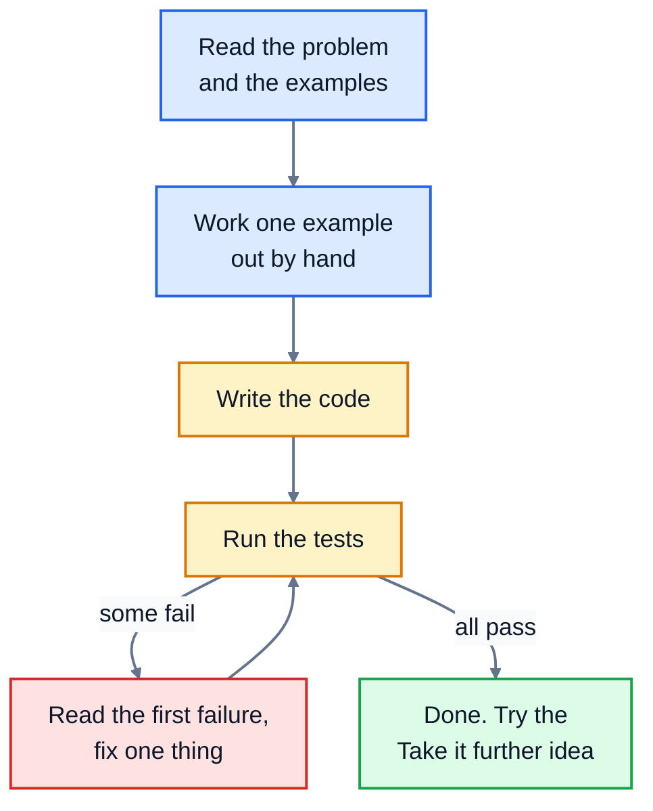

# Python Practice

Twenty programming problems for building real fluency in Python, from warm-ups to small complete programs. Each one comes with clear rules, worked examples, tests that check your answer, and hints that you can open one at a time.

Reading about programming only gets you so far. You get good by solving problems, getting stuck, and working your way out. That's what this repo is for.

## Who this is for

You know the basics of Python: variables, `if`, loops, functions, lists and dictionaries. If you don't yet, work through [Python Basics](https://github.com/The-Future-Root/python-basics) first. Problems 13 onwards also use recursion, `try`/`except` and files.

## What you need

- **Python 3.10 or newer**, from [python.org](https://www.python.org/downloads/). Check with `python3 --version` (on Windows, `python --version`).
- **A text editor**, such as VS Code.

The tests use `unittest`, which is built into Python, so there's nothing to install.

## The problems

| # | Problem | Level | You'll practise |
|---|---|---|---|
| 1 | [Hello, you](./01-hello-you/) | Easy | `input()`, string methods, f-strings |
| 2 | [Simple calculator](./02-simple-calculator/) | Easy | functions, `if`/`elif`, raising exceptions |
| 3 | [Even or odd](./03-even-or-odd/) | Easy | the `%` operator, returning text |
| 4 | [FizzBuzz](./04-fizzbuzz/) | Easy | loops, `%`, the order of `if` checks |
| 5 | [Sum of 1 to n](./05-sum-to-n/) | Easy | loops, accumulators, a maths shortcut |
| 6 | [Reverse text](./06-reverse-text/) | Easy | loops over strings, slicing, `split` and `join` |
| 7 | [Count vowels](./07-count-vowels/) | Easy | loops over strings, `in`, dictionaries for counting |
| 8 | [Palindrome check](./08-palindrome/) | Easy | cleaning strings, comparing with a reversed copy |
| 9 | [Word counter](./09-word-counter/) | Medium | cleaning text, counting with a dictionary, sorting with a key |
| 10 | [Find the max](./10-find-max/) | Easy | tracking the best value in a loop |
| 11 | [Remove duplicates](./11-remove-duplicates/) | Easy | building a new list, checking membership |
| 12 | [Second largest](./12-second-largest/) | Medium | tracking two values at once, edge cases |
| 13 | [Flatten a list](./13-flatten-a-list/) | Medium | nested loops, recursion, `isinstance` |
| 14 | [Prime numbers](./14-prime-numbers/) | Medium | loops with early exits, making code faster |
| 15 | [Factorial](./15-factorial/) | Easy | loops, recursion, raising errors |
| 16 | [Caesar cipher](./16-caesar-cipher/) | Medium | `ord()` and `chr()`, the `%` operator, building strings |
| 17 | [Temperature converter](./17-temperature-converter/) | Medium | formulas, validating input, organising conversions |
| 18 | [Number guessing game](./18-number-guessing-game/) | Medium | `while` loops, the `random` module, handling bad input |
| 19 | [To-do list](./19-to-do-list/) | Harder | a command loop, lists, error handling, saving to a file |
| 20 | [Grade report](./20-grade-report/) | Harder | dictionaries of lists, sorting by more than one thing, functions working together |

They get harder as you go, but each one stands on its own. If one doesn't appeal, skip it and come back later.

## How to work on a problem



1. **Read the problem and its examples** in the folder's `README.md`.
2. **Work an example out by hand**, on paper if it helps. If you can't do it by hand, you can't tell the computer how to do it.
3. **Write your code** in `exercise.py`.
4. **Run the tests** from the problem's folder:

   ```bash
   cd 04-fizzbuzz
   python3 -m unittest -v
   ```

5. **Fix the first failing test**, then run them again. Each failure says what the test expected and what your code gave back.

You can also try your functions out in the Python shell. Start `python3` in the problem's folder, then:

```
>>> from exercise import fizzbuzz
>>> fizzbuzz(5)
['1', '2', 'Fizz', '4', 'Buzz']
```

## When you're stuck

Every problem has three hints, hidden until you click them. The first is a gentle nudge, the last is close to the answer. Open one, try again, and only open the next if you need it. Full solutions are in [solutions/](./solutions/), but you'll learn far more from a working answer of your own, however long it takes, than from reading someone else's.

## License

The code in this repository is released under the [MIT License](./LICENSE). The problem descriptions are released under [Creative Commons Attribution 4.0](./LICENSE-CONTENT) (CC BY 4.0): you may share and adapt them, including for your own teaching, as long as you credit The Future Root.
